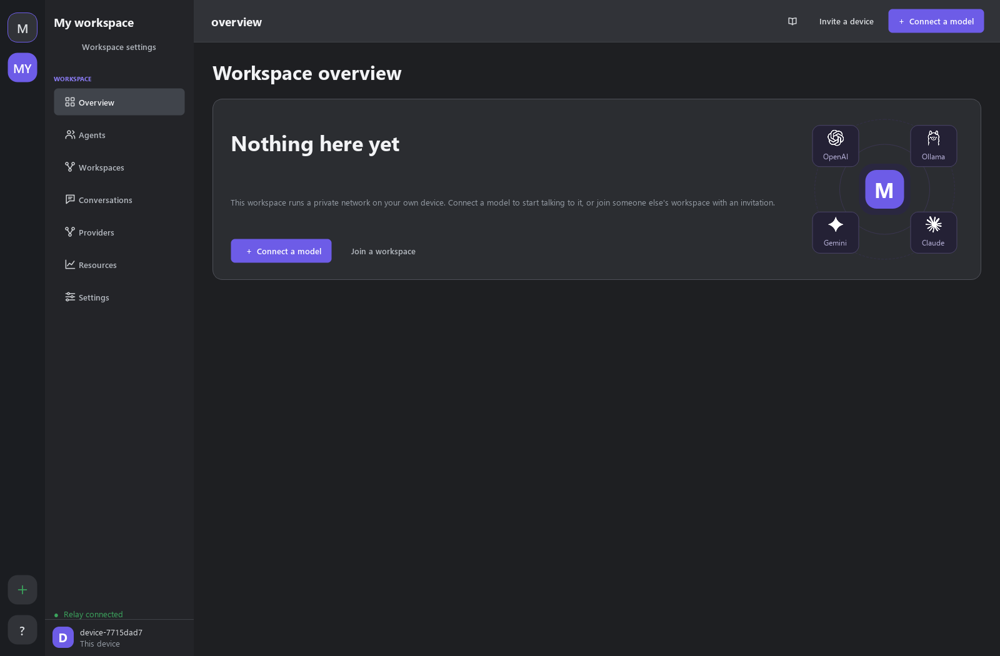
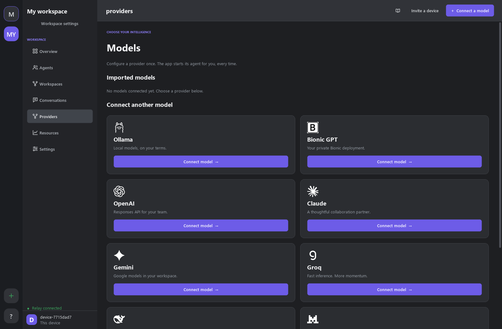
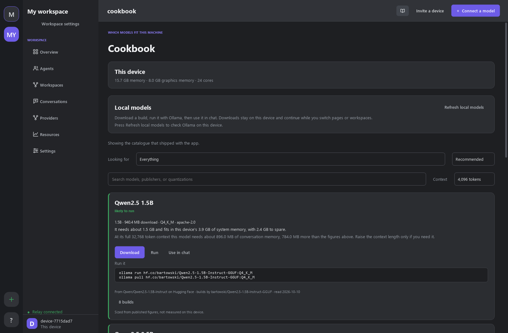
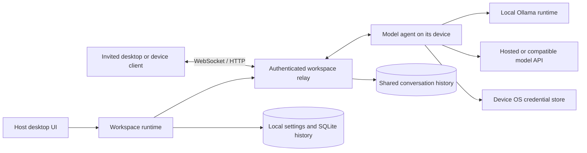

# Multiplayer AI

A native desktop app for chatting with AI models and sharing conversations across
devices. Connect local or hosted models, create workspaces, and invite people to
work in the same chat without sharing your provider credentials.

The project is under development. The desktop app, authenticated device relay,
and model adapters are available. The separate Connection Server in `src/` is a
development component with no client authentication or session management.

## App screenshots

Screenshots of the native desktop app, captured with a fresh local workspace.

**Workspace overview** — connect a model or join another device's workspace.



**Providers** — connect local models, hosted APIs, or your own compatible endpoint.



**Cookbook** — browse model builds and estimated hardware requirements before
downloading. Recommendations depend on the device running the app.



## Get started

You need **Python 3.13 or newer**. Download or clone this repository, then open a
terminal in its root folder, where `requirements-desktop.txt` lives.

**Windows (PowerShell):**

```powershell
python -m venv .venv
.\.venv\Scripts\python.exe -m pip install -r requirements-desktop.txt
.\.venv\Scripts\python.exe -m desktop_app
```

**macOS / Linux:**

```sh
python3 -m venv .venv
./.venv/bin/python -m pip install -r requirements-desktop.txt
./.venv/bin/python -m desktop_app
```

On Linux, unlock a Secret Service keyring before launching. The app saves secrets
in your operating system's credential store: Windows Credential Manager, macOS
Keychain, or Linux Secret Service.

To open the app again, run the last command. Setup creates the local relay and
device identity automatically; you do not need to start a server separately.
For Conda or development setup, see the [development guide](DOCUMENTATION.md#development-environment).

## Send your first message

1. Open **Providers** and choose your provider.
2. Enter its API key and select a model. For local models, install
   [Ollama](https://ollama.com/download) first, then use **Cookbook** to download
   and run a model.
3. Click **Connect agent**. Chat opens automatically; send a message.
4. Use **Invite a device** to bring someone into the workspace chat with its
   existing history. They open directly into that chat after joining.
   **Invite to conversation** shares a separate model conversation.

The first imported model becomes the default. You can add more models and assign
specialist roles later. See the [desktop guide](DESKTOP_GUIDE.md) for those steps.

## Architecture overview

Each owned workspace starts an authenticated relay on its host device. Desktop
clients and model agents connect to that relay; a model agent calls the local
Ollama runtime or its configured hosted provider. Each workspace controls its own
relay and data, without a mandatory project-operated central service. Within a
workspace, communication still passes through one host rather than a peer mesh.



- **Desktop and runtime:** PySide6 draws the interface. A dedicated Qt thread
  runs the asyncio networking runtime so provider calls and relay work do not
  block the UI. Owned workspaces retain their relays when you switch pages or
  workspaces.
- **Communication and membership:** `network_a2a/` authenticates device tokens,
  enforces group and conversation access, discovers connected agents, and routes
  requests and replies over WebSockets or authenticated HTTP. Invitations give
  each device its own identity.
- **Models and orchestration:** provider adapters run on the model's device.
  The workspace's Head answers directly or delegates up to three ordered tasks
  to authorized specialists, then combines their results. Provider keys and
  private model instructions stay on the device that runs the adapter.
- **Persistence:** JSON files store preferences and workspace configuration;
  SQLite stores chat archives and shared history. Secrets use the OS credential
  store. Guests cache history locally for offline reading, while the host
  coordinates new shared messages.
- **Cookbook and attachments:** Cookbook combines a bundled or refreshed model
  catalogue with local hardware readings and controls local Ollama models.
  Images and PDFs are prepared on the sending device before being included in
  model requests and shared chats.

The separate Connection Server in `src/` can forward agent requests to the relay
through its gateway. It uses a different protocol and is not part of the normal
desktop startup. See the [development architecture guide](DOCUMENTATION.md#architecture)
for the module map.

## Technology details

| Area | Technologies and role |
| --- | --- |
| Language and concurrency | Python 3.13+, asyncio, and Qt threads/signals |
| Native desktop | PySide6 / Qt Widgets; Qt PDF and image support for attachments |
| Relay and APIs | Starlette on Uvicorn, `websockets` for persistent connections, HTTPX for async HTTP |
| Model integrations | Ollama, OpenAI Responses, Anthropic Messages, Gemini generateContent, Bionic GPT, and OpenAI-compatible chat APIs including Groq, DeepSeek, Mistral, and OpenRouter |
| Local model discovery | Bundled JSON catalogue, optional Hugging Face metadata refresh, RAM/VRAM/storage estimates, and Ollama download/run controls |
| Resource monitoring | `psutil` for local CPU, memory, disk, and process readings |
| Storage and credentials | SQLite with write-ahead logging, JSON preferences, and `keyring` backed by the OS credential store |
| Protocol validation | Custom JSON relay frames; Pydantic models for the separate Connection Server's envelopes |
| Optional relay deployment | Docker Compose and Caddy for a self-hosted TLS/WSS endpoint |
| Development and distribution | pytest, pytest-asyncio, Ruff configuration, and a PyInstaller desktop build specification |

Provider adapters use HTTPX directly, without requiring individual provider
SDKs. Exact dependency constraints live in `requirements-desktop.txt`,
`requirements-network.txt`, and `requirements-dev.txt`.

## Limitations

- **LAN-first sharing and WAN infrastructure:** the default sharing workflow
  targets a trusted LAN. Communication across networks needs a reachable server
  or relay, plus TLS and network configuration. To avoid depending on a WAN
  communication service whose server component was not available as open source,
  we opted out of bundling that service and kept the default experience locally
  hosted and open source. Ownership is decentralized across workspaces, but each
  workspace still depends on its host relay. The relay code in this repository
  **is open source** and can optionally be self-hosted for WAN access using the
  [network setup guide](NETWORK_SETUP.md#4-deploy-for-internet-access). The app
  does not provide managed WAN hosting, NAT traversal, or automatic router and
  firewall configuration.
- **Host availability and scale:** shared messaging requires the host to be
  online. Connections and in-flight requests live in one relay process; run one
  worker and one replica. There is no automatic host failover, durable offline
  request queue, or multi-replica routing. Reconnection is supported, but failed
  or interrupted requests are not automatically replayed.
- **Transport privacy and administration:** plain `ws://` LAN traffic is
  unencrypted. WSS encrypts the device-to-relay connection, but the relay can
  read payloads; end-to-end encryption is not implemented. Device tokens, group
  isolation, owner controls, and member removal exist, but there is no
  comprehensive administration console or fine-grained organization policy
  system. Chat archives are stored locally without application-level encryption.
- **Workspace membership:** the desktop currently supports one joined remote
  workspace at a time. Each connected device or agent needs a distinct identity;
  the relay rejects simultaneous connections using the same identity.
- **Model context and response handling:** the saved archive is complete, but
  requests use at most 100 recent messages within byte limits, so older context
  may be omitted. Adapters return complete responses rather than streaming
  tokens to the UI. Delegation has a four-minute overall limit and can increase
  provider calls, latency, and cost; assigned roles do not verify model abilities.
- **Attachment limits:** up to eight files per message, 20 MiB per source file,
  and an 8 MiB prepared-request budget. PDFs are limited to 200 pages; page images
  are included only for PDFs of 16 pages or fewer. Image and scanned-PDF support
  depends on the selected model's vision capabilities.
- **Cookbook coverage:** compatibility verdicts estimate memory and storage fit;
  they do not certify performance or successful execution on a device. Hardware
  detection and model metadata can be incomplete. Built-in download and run
  controls target local Ollama GGUF builds, and recommendations describe the
  current device rather than every device in a workspace.
- **Agent interoperability and guardrails:** the relay is a custom transport,
  not a standard A2A endpoint with Agent Cards or streaming. The local A2A bridge
  supports synchronous JSON responses. MCP integration is not implemented.
  Routing validates access, task assignments, and payload sizes, but the app has
  no dedicated content-moderation or prompt-injection defense layer. Models
  answer through APIs; returned code is not automatically executed.

## Future improvements

These are planned directions, not features available in the current release.

- **A more developed Cookbook:** expand model coverage, setup recipes, and
  measured compatibility reports across operating systems and hardware. Let
  users inspect models that could run on other workspace devices, with device
  owners controlling which hardware details they share.
- **MCP support:** add Model Context Protocol clients for tools, resources, and
  prompts, with explicit permissions and controlled access to external systems.
- **HDFS-inspired architecture:** implement a distributed storage layer for
  shared history and attachments, using replication and recovery alongside
  durable messaging and host failover to make device communication more robust.
- **Administration controls:** extend existing owner and membership controls
  with granular roles, model and tool permissions, audit history, usage limits,
  and centralized workspace policy management.
- **Improved AI guardrails:** strengthen prompt-injection defenses, sensitive
  data handling, input/output policy checks, and approval controls for future
  tool actions, backed by safety evaluations.

## AI usage during development

AI tools assisted with the following parts of the project:

| Tool or model | Contribution |
| --- | --- |
| CodeRabbit | Documentation |
| ChatGPT 6 Astra | UI development |
| Open-source models, including Qwen Coder 37B Instruct | Agent-to-agent (A2A) logic and server configuration |

## Choose a guide

| I want to... | Read |
| --- | --- |
| Use chat, local models, attachments, or shared workspaces | [Desktop guide](DESKTOP_GUIDE.md) |
| Configure a provider or run a model agent from a terminal | [Provider adapters](PROVIDER_ADAPTERS.md) |
| Host a relay or connect devices over a LAN or the internet | [Network setup](NETWORK_SETUP.md) |
| Run tests, understand the code, or build a desktop bundle | [Development guide](DOCUMENTATION.md) |
| Read the guides offline | [Offline documentation](docs.html), also available from **?** in the app |

## Repository layout

| Path | Purpose |
| --- | --- |
| `desktop_app/` | Qt desktop interface, workspaces, local models, and saved settings |
| `network_a2a/` | Authenticated relay, device client, model adapters, and shared chats |
| `src/` | Client Connection Server and its agent gateway |
| `scripts/` | Documentation builder, demo client, and model catalogue tools |
| `docs/screenshots/` | Native app screenshots displayed in this README and embedded in offline help |
| `tests/` | Automated tests |
| `requirements-*.txt` | Desktop, networking, and test dependencies |

The desktop app uses the relay in `network_a2a/`. The Connection Server in `src/`
has a separate message format and is not required to use the desktop app.

Licensed under [MIT](LICENSE).
